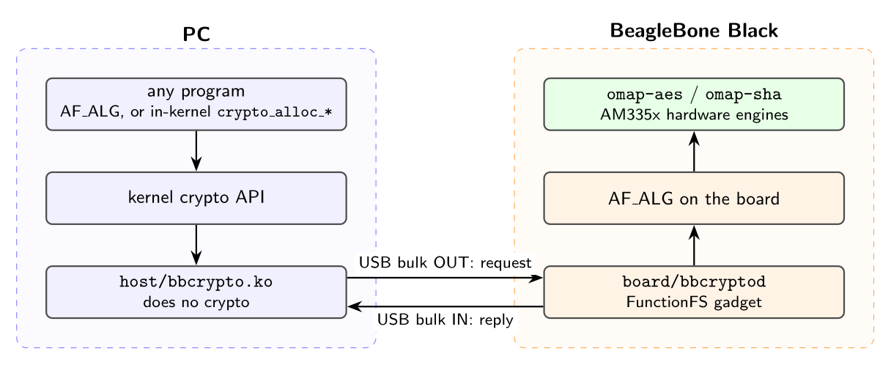

# bbcrypto

A BeagleBone Black (BBB) plugged into a Linux PC over USB works as a crypto accelerator. A kernel
module on the PC registers SHA, HMAC, AES and GCM with the kernel crypto API. Each request is sent
over a USB bulk pipe to a daemon on the board, which runs it on the AM335x hardware AES/SHA engines
and sends the result back.



The diagram is `figures/architecture.tex` (standalone TikZ, rebuild with `make -C figures`).

Speed is about 2.8 to 6.5 MB/s, far below the PC's own CPU. This is a driver project, not a speedup.

| algorithm | driver name (for AF_ALG bind) | kind |
|---|---|---|
| sha1, sha256, hmac(sha256) | `sha1-bbcrypto`, `sha256-bbcrypto`, `hmac-sha256-bbcrypto` | shash |
| same three, asynchronous | `sha1-async-bbcrypto`, `sha256-async-bbcrypto`, `hmac-sha256-async-bbcrypto` | ahash |
| ecb / cbc / ctr (aes) | `ecb-aes-bbcrypto`, `cbc-aes-bbcrypto`, `ctr-aes-bbcrypto` | skcipher |
| gcm(aes) | `gcm-aes-bbcrypto` | aead (aad + data up to 32 KiB) |

They register at priority 50, so nothing uses them unless asked by driver name. Load the module with
`prio=400` to make plain `sha256`, `cbc(aes)` and so on go to the board.

## Layout

```
proto.h       wire protocol shared by both sides (read this first)
host/         the kernel module, bbcrypto.c (runs on the PC)
board/        bbcryptod.c (daemon), OpenRC services, setup-gadget.sh, install.sh, build.sh, kernel.config
tests/        afalg_test.c, the functional suite (runs against the real board)
tools/        bbcrypt.c (command line client), board_aes.c (proves the AES engine is hardware)
demos/        eleven usage examples over AF_ALG, run_all.sh runs the quick ones
scripts/      deploy-host.sh, deploy-kernel.sh, fetch-sysroot.sh, bbb-net-up.sh, bbb-internet.sh
figures/      standalone TikZ architecture diagram (tex, png, svg)
report/       LaTeX report (main.tex, built to main.pdf)
```

## How to proceed

You need two machines or one: the **dev machine** where you edit and build, and the **target PC**
the board is plugged into. They can be the same computer.

### 0. Requirements

- A BeagleBone Black running Alpine (OpenRC) with a kernel that has the options in `board/kernel.config`
  (omap AES and SHA engines, USB gadget with configfs and FunctionFS, MUSB). Reachable as `root@192.168.7.2`.
- Dev machine: `gcc`, `make`, `clang` and `lld`, `curl`, `ssh`.
- Target PC: Linux with kernel headers (the deploy script installs them with apt, dnf or pacman if missing),
  `sudo`, and the board on its USB port.
- Secure Boot must be off, because the module is unsigned.

### 1. Give the board an address (dev machine)

When the board is plugged in it shows up as a USB Ethernet device. Set the PC side of that link:

```
sudo scripts/bbb-net-up.sh        # then: ssh root@192.168.7.2   (password beagle)
```

Optional, so the board can `apk add` things: `sudo scripts/bbb-internet.sh` (undo with `off`).

### 2. Build and install the daemon on the board

```
make board                # downloads an Alpine musl sysroot into build/ and cross-builds board/bbcryptod
make install-board        # BOARD=192.168.7.2 BOARD_PASS=beagle   copies the daemon and OpenRC services, restarts
```

The restart runs detached on the board and the link drops for about 20 seconds. Never kill `bbcryptod`
by hand while the gadget is bound, use `rc-service bbcrypto restart`. The old daemon is kept on the board
as `/root/bbcryptod.prev`, the original gadget script as `/root/usbgadget.orig`.

### 3. Build, install, load and test the module on the target PC

From the dev machine:

```
make deploy HOST=user@target-pc            # add SUDO_PASS=... if sudo asks for a password
```

This copies the sources to `~/bbcrypto` on the target, builds against its **running** kernel, installs
`bbcrypto.ko` into `/lib/modules/<ver>/extra`, runs `depmod` (so plugging the board autoloads the driver),
loads it, waits for the board to bind, and runs the test suite. Success looks like
`0 failed` at the end. The previous copy of the sources is kept in `~/bbcrypto/.prev`.

Options for `scripts/deploy-host.sh`: `--build-only` (compile locally, install nothing), `SKIP_TEST=1`,
`UNPLUG=1` (also run the unplug and replug test).

If the target kernel has no headers or lacks AF_ALG AEAD, build and install a matching kernel first as an
extra one-shot boot entry: `scripts/deploy-kernel.sh user@target-pc build`, then `install`, reboot, then
step 3.

### 4. Use it

On the target PC:

```
bbcrypt hash sha256 file                  # through the board
bbcrypt -b hash sha256 file               # same thing in the kernel, for comparison
bbcrypt gcm-enc ...                       # also enc/dec ecb|cbc|ctr, hmac, gcm-dec
cat /sys/bus/usb/drivers/bbcrypto/*/stats # requests, bytes, errors, retries, latency
cd ~/bbcrypto/demos && ./run_all.sh       # the demos
sudo modprobe bbcrypto prio=400     # make ordinary algorithm names use the board
```

Module parameters: `prio`, `window` (commands in flight, 1 to 8, default 4), `chunk` (bytes per command,
multiple of 16, up to 32768, default 16384). `window` and `chunk` can be changed at run time under
`/sys/module/bbcrypto/parameters/`.

### Building only the module

```
make -C host KDIR=/path/to/kernel/build     # KDIR defaults to the running kernel's tree
```

## Everyday commands

| command | does |
|---|---|
| `make` | module, tests, board daemon |
| `make deploy HOST=...` | build, install, load and test on the target PC |
| `make install-board` | install the daemon and services on the board |
| `make format` | apply `.clang-format` |
| `make lint typecheck` | static checks, no hardware (lint needs `clang-format` and `pyflakes`) |
| `make setup` | enable the git pre-commit hook, which runs lint and typecheck |
| `make clean` | remove build outputs |

## Troubleshooting

- **Board does not bind**: check `lsusb | grep 1d6b`, then `dmesg | tail`. If the board is not on USB, replug it
  or `rc-service bbcrypto restart` on it.
- **`load failed`**: Secure Boot rejects unsigned modules.
- **Requests return `-ENODEV`**: no board is attached. The algorithms stay registered while the module is loaded.
- **`bbcrypt enc|dec` fails on big files**: one AF_ALG request is limited to 192 KiB by the socket buffer.
- **Board hangs after killing the daemon**: always unbind the gadget first, use the OpenRC service.

## How it works, briefly

- The module runs an asynchronous command engine. Up to `window` tagged commands are on the wire at once.
  Replies are matched by tag. A timer resends overdue commands, and the board answers a repeated tag from a
  16 entry reply cache, so nothing runs twice.
- Ciphers are asynchronous. A large request is cut into `chunk` byte commands. ECB, CTR and CBC decrypt chunks
  run pipelined, CBC encrypt is a serial chain and runs one chunk at a time.
- Hashes use the synchronous shash API (and an async ahash twin) on the same engine, with sessions on the board.
- The board kernel has no AF_ALG AEAD, so GCM is assembled in `bbcryptod`: AES on the hardware engine through
  `ecb(aes)` and `ctr(aes)`, GHASH in software.
- The AM335x MUSB can drop the first packet of a transfer when no read is queued, so the daemon always keeps
  12 AIO reads queued.
- On unplug every pending request fails with an error and nothing hangs. The algorithms are not unregistered.

The full explanation, with figures and measurements, is the report: build it with
`cd report && latexmk -pdf main.tex`, or open `report/main.pdf`.

## License

GPL-2.0, see `LICENSE`.
